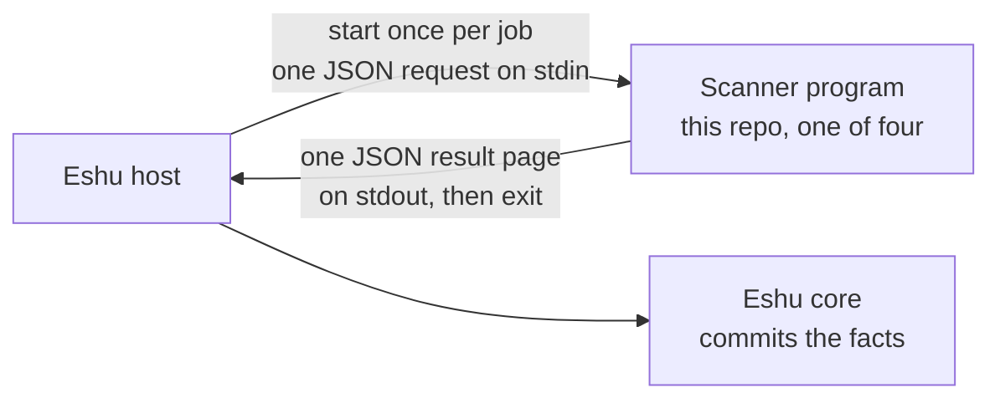

# eshu-scanner-worker

Status: pre-release. Three scanners were moved here from Eshu core.
A fourth, Go reachability, is new here and core doesn't admit it yet
(see [INTERIM.md](INTERIM.md)).

Let's get this out of the way first: this repo is not a service.
There's no daemon, nothing listens on a port, and nothing polls for
work. It's four short-lived scanner programs. Eshu's host starts one
per job, it reads one JSON request from standard input, scans one
target, writes one JSON result page to standard output, and exits.



In words: the host starts one scanner per job and feeds it one
request. The scanner writes one result page and exits. The host
sends the result to core. Nothing here stays running between jobs.

## When you'd use it, and when you wouldn't

You'd use these when Eshu's host needs an image scan, an SBOM build,
an OS package listing, or a Go reachability check, installed from
the matching image. The four programs are listed in the
[per-binary map](docs/architecture/README.md).

Don't come here for a long-running service to deploy, for stored or
queryable results (the host and core handle that), or for a scanner
kind that isn't one of the four. Unknown component ids and unknown
config keys fail closed.

## How Eshu runs it

It goes like this: a seed step installs each program from its
digest-pinned image into a runtime directory, writing `collector`
plus a `manifest.yaml` with the image reference stamped in. Core
checks that reference against its own pins before admitting work.
Then, per claim, the host runs the seeded program with no arguments,
writes one request to stdin, and reads one result page from stdout,
re-invoking with a cursor if more pages remain.

The same shape works locally:

```bash
go run ./go/cmd/scanner-component-osruntime --version   # probe only
go run ./go/cmd/scanner-component-osruntime < request.json > result.json
```

## Documentation

| Doc | What's in it |
|---|---|
| [docs/README.md](docs/README.md) | Documentation index: start here |
| [docs/getting-started/README.md](docs/getting-started/README.md) | Probe a binary and drive one stdio call by hand |
| [docs/guides/](docs/guides/README.md) | Operate, troubleshoot, seed, and release |
| [docs/concepts/](docs/concepts/README.md) | The per-job contract and boundaries |
| [docs/reference/configuration.md](docs/reference/configuration.md) | The request config keys and the command line surface |
| [docs/architecture/README.md](docs/architecture/README.md) | Place in Eshu, with the per-binary map |
| [docs/diagrams/README.md](docs/diagrams/README.md) | Every diagram, with captions and text versions |
| [docs/decisions/README.md](docs/decisions/README.md) | Architecture decision records |
| [docs/contributing/README.md](docs/contributing/README.md) | Local checks before a pull request |
| [INTERIM.md](INTERIM.md) | Port state and what's still staged |
| [SECURITY.md](SECURITY.md) | Supported versions, token rules, and input budgets |
| [CONTRIBUTING.md](CONTRIBUTING.md) | CI lanes and local checks |

Quick glossary: a claim is one unit of work Eshu hands out (the host
holds it, these programs only see the request built from it), a fact
is one stored observation, an SBOM is a list of the components in a
build, and a rootfs is a container image's file system after
unpacking.

## Related repos

- [eshu](https://github.com/eshu-hq/eshu): core. Its host starts
  these programs and commits their facts.
- [eshu-sdk](https://github.com/eshu-hq/eshu-sdk): the collector
  contract. These programs speak `collector-sdk/v1alpha3`.
- [eshu-extension-host](https://github.com/eshu-hq/eshu-extension-host):
  the standalone supervisor for component collectors like these.

## Development

Go `1.26.10` (pinned in `go.mod`). Run `make ci` for the same lint,
test, and race lanes CI runs.

## Contributing, security, license

See [CONTRIBUTING.md](CONTRIBUTING.md) before opening a pull
request. Report security problems as described in
[SECURITY.md](SECURITY.md), not as a public issue. Source files
carry `SPDX-License-Identifier: MIT`. There's no separate LICENSE
file in this tree.
