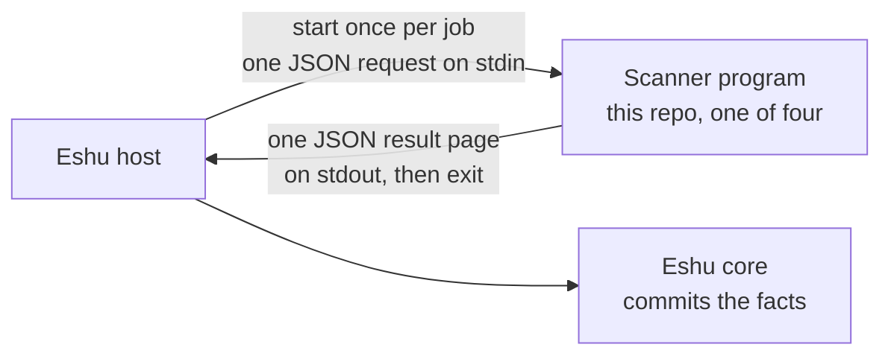

# eshu-scanner-worker

Status: pre-release. Three scanners were moved here from Eshu core.
A fourth, Go reachability, is new here and core does not admit it yet
(see [INTERIM.md](INTERIM.md)).

One-line identity: four short-lived scanner programs. Each reads one
request, scans one target, writes one result, and exits.

## What it is

This repo is not a service. There is no daemon — no process that runs
forever, listens on a port, or polls for work. Each program below is
started by Eshu's host for a single job, reads one JSON request from
standard input, writes one JSON result page to standard output, and
ends. Structured log lines go to standard error, so stdout carries the
result alone.

Words used in this file:

- Claim: one unit of work Eshu hands out. The host holds the claim;
  these programs only see the request built from it.
- Fact: one stored observation Eshu keeps, such as "this image has
  package X." These programs emit facts in their result; the host
  commits them.
- SBOM: a software bill of materials — a list of the components in a
  build.
- Rootfs: a container image's file system after unpacking its layers.

## The four programs

All four live under `go/cmd/` and share one entry point
(`component.Main`):

| Program (source) | Image binary | Component id | Scans |
|---|---|---|---|
| `go/cmd/scanner-component-image` | `eshu-scanner-component-image` | `eshu.scanner.image` | Container images: unpacks layers and finds OS packages |
| `go/cmd/scanner-component-sbom` | `eshu-scanner-component-sbom` | `eshu.scanner.sbom` | Repositories: builds an SBOM from lockfiles |
| `go/cmd/scanner-component-osruntime` | `eshu-scanner-component-osruntime` | `eshu.scanner.osruntime` | An unpacked OS file system: lists installed OS packages |
| `go/cmd/scanner-component-go-reachability` | `eshu-scanner-component-go-reachability` | `eshu.scanner.go-reachability` | One Go repository at one commit: module evidence and call reachability |

Protocol on the wire: `collector-sdk/v1alpha3`. Results can span
several pages: the host re-invokes the program with a continuation
cursor until the final page. A request is capped at 1 MiB.

## Why it exists

Scanners parse untrusted input — image layers, package databases,
lockfiles, repository checkouts. Keeping each scan in its own
one-shot program limits the blast radius: it owns no claim, no store,
and (except Go reachability's fetch) no network. The host validates
the claim and permissions before launch.



Text version: the host starts one scanner per job and feeds it one
request. The scanner writes one result page and exits. The host sends
the result to core. Nothing here stays running between jobs.

## When to use it

Use these programs when Eshu's host needs one of the four scans above,
installed from the matching image (see Deploy).

Do not use this repo when:

- You need a long-running service to deploy. There is none here.
- You need results stored or queried. The host and core do that.
- You need a scanner kind not listed above. Unknown component ids and
  unknown config keys fail closed.

## How Eshu runs it

Eshu does not exec the image entry point per claim. First, a seed
step installs the program from its image into a runtime directory:

```bash
/usr/local/bin/eshu-scanner-component-<name> seed --dest DIR --image-ref REF
```

Seed writes `DIR/collector` (the program itself) and `DIR/manifest.yaml`
(its declaration, with `REF` stamped in). `REF` must be the
digest-pinned image for that component
(`ghcr.io/eshu-hq/scanner-<name>@sha256:...`); anything else is
refused. Core checks the stamped reference against its own pins before
admitting work. The `go-reachability` seed also copies a Go toolchain
and `govulncheck` to `DIR/toolchain`.

After seeding, the flow per claim is:

1. The host validates the claim, the activation (its saved settings),
   and producer grants (permission records for fact kinds).
2. The host runs the seeded program with no arguments, writing one
   request JSON to stdin.
3. The program scans and writes one result page to stdout. Exit code
   `0` means success; `1` means the call failed and the host treats it
   as a retryable launch failure.
4. If more pages remain, the host runs it again with the cursor from
   the last page.

Locally, the same shape works by hand:

```bash
go run ./go/cmd/scanner-component-osruntime --version   # probe only
go run ./go/cmd/scanner-component-osruntime < request.json > result.json
```

## How it works

Data in: one request holding the claim, the contract, and config. For
image, SBOM, and osruntime the config carries `targets` (what to scan,
in each scanner's own shape), `acceptance_unit_id` (the unit the claim
covers; it must match the claim scope), and optional
`page_bound_bytes`.

Data out: facts, per component. These lists come from each
component's manifest declaration in
`go/internal/collector/scannerworker/component/manifest.go`:

- image: `scanner_worker.analysis`, `scanner_worker.warning`,
  `vulnerability.os_package`, `vulnerability.warning`
- sbom: `sbom.document`, `sbom.component`, `sbom.warning`
- osruntime: `vulnerability.os_package`, `vulnerability.warning`
- go-reachability: `vulnerability.go_module_evidence`,
  `vulnerability.go_call_reachability`, `vulnerability.warning`,
  `scanner_worker.warning`

The first three scanners were ported from core. Their output is tested
against recorded expected outputs from core, with one known
difference: rootfs `vulnerability.os_package` facts carry the claim
observation time, not the file-read time. See [INTERIM.md](INTERIM.md).

Go reachability is different in three ways. It takes its target and a
short-lived GitHub installation token from the host (config keys
`host_derived_target` and `host_github_app_token`), not from saved
settings. It fetches one commit, reads `go.mod` files, then runs the
seeded `govulncheck` per module. The token goes only to `github.com`
unless the operator's `allowed_clone_hosts` setting names other hosts.
It needs a `git` binary on `PATH` in the process that runs it. Limits,
token handling, and failure rules are detailed in
[SECURITY.md](SECURITY.md).

## Configuration

There are no environment variables, ports, or config files to set on
these programs. Settings arrive inside the request's config block:

| Key | Used by | Meaning |
|---|---|---|
| `targets` | image, sbom, osruntime | What to scan; at least one required |
| `acceptance_unit_id` | image, sbom, osruntime | Unit the claim covers; must not be blank |
| `page_bound_bytes` | all | Optional smaller page cap; values above the default are clamped; negative fails |
| `host_derived_target` | go-reachability | Host-supplied repository and commit |
| `host_github_app_token` | go-reachability | Host-minted token for the fetch; other components reject this key |
| `allowed_clone_hosts` | go-reachability | Hosts the token may reach; absent means `github.com` only |

Command line surface, per program: no arguments runs one stdio call.
`--version` (or `-v`) prints the version and exits. `seed --dest DIR
--image-ref REF` performs the install step described above.

## Deploy

Do not deploy these as services. Eshu runs them per claim, so
"deploying" means publishing images and seeding from them.

One `Dockerfile` builds all four binaries. Each final image stage
holds one program on a distroless base with no shell:
`ghcr.io/eshu-hq/scanner-image`, `ghcr.io/eshu-hq/scanner-sbom`,
`ghcr.io/eshu-hq/scanner-osruntime`, and
`ghcr.io/eshu-hq/scanner-go-reachability`. That last image also
carries `govulncheck` and a trimmed Go toolchain for its seed step.

Releases: pushes to `main` and version tags run
`.github/workflows/release.yml`, which publishes the images. Core
consumes them by digest; a new publish only takes effect when core
re-pins it (see [SECURITY.md](SECURITY.md)). To build locally:

```bash
docker build --target scanner-osruntime -t scanner-osruntime .
```

## Eshu dependencies

- Needs: a host that supplies one valid request per run. Go
  reachability also needs `git` on `PATH`, the seeded toolchain, and
  network access to the clone host for its single fetch.
- Talks to: only its stdin and stdout, plus (go-reachability only) the
  git remote for the claimed commit.
- Never touches: Postgres, the graph, queues, or claim state. The
  programs own no claim and no store; `boundary_test.go` fails the
  build on any import of core internals.

## Operations

There is no health endpoint because there is no server. The operator
signals are per run:

- Exit code: `0` success, `1` failure (host treats it as retryable).
- stderr: structured log lines for the run. Target names, paths, and
  credentials stay out of logs and errors by design.
- stdout: exactly one result document. Warning facts inside it name
  what could not be read, so a partial scan still says what is missing.
- Admission is the common failure point: if Eshu refuses work, check
  that the seeded `manifest.yaml` image reference matches core's pin
  and that `DIR/collector` is executable (re-seeding repairs drift).

## Development

Go version is pinned in `go.mod` (`go 1.26.10`, module
`github.com/eshu-hq/eshu-scanner-worker`). SDK pins:
`eshu-sdk/collector v0.2.0-rc.3` and `eshu-sdk/factschema v0.1.0-rc.17`
(from `go.mod`). `govulncheck` is pinned by the `tool` directive.

```bash
make ci       # lint + test + race, same commands CI runs
make ci-lint  # vet, golangci-lint, tidy check, 500-line cap
make ci-test  # build + full test suite
make ci-race  # race suite + coverage floor (96.8)
make help     # list targets
```

`scripts/scanner-worker-seed-matrix.sh` is a local checker (not a CI
gate) that proves each lint and test lane catches a planted defect.

## Docs and related

- [INTERIM.md](INTERIM.md) — port state and what is still staged.
- [SECURITY.md](SECURITY.md) — supported versions, token rules, and
  input budgets.
- [CONTRIBUTING.md](CONTRIBUTING.md) — CI lanes and local checks.

## Contributing, security, license

See [CONTRIBUTING.md](CONTRIBUTING.md) before opening a pull request.
Report security problems as described in [SECURITY.md](SECURITY.md);
do not open a public issue for them. Source files carry
`SPDX-License-Identifier: MIT`; there is no separate LICENSE file in
this tree.
