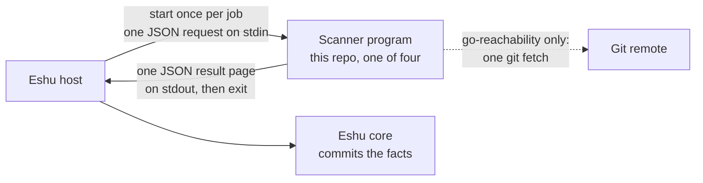
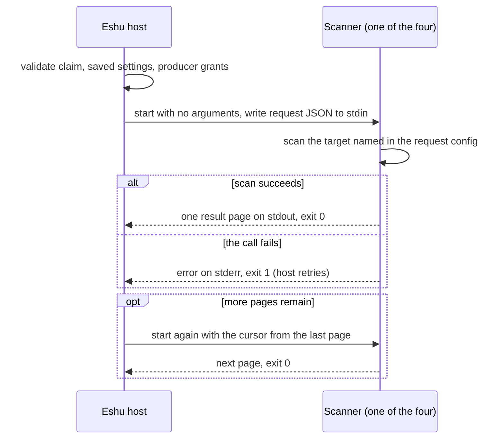

# Diagrams

Every diagram for `eshu-scanner-worker` lives here, each
with a caption and a text version. Other pages link here
instead of copying diagrams. The
[top-level README](../../README.md) keeps the first overview
only. Note what's absent: there's no server box, because
there is no server.

## Where a scanner sits

Caption: the host starts one scanner per job and feeds it
one request; the scanner writes one result page and exits;
the host sends the result to core. Only go-reachability
reaches outside its own process, with one git fetch.

Text version: Eshu host → (start once per job, one JSON
request on stdin) → scanner program → (one JSON result page
on stdout, then exit) → host → Eshu core commits the facts.
Go reachability only: scanner → (one git fetch) → git remote.

## One invocation, whichever binary you picked

Caption: every program runs the same lifecycle; only the
scan in the middle differs. Exit 0 is success, exit 1 is a
retryable failure, and extra pages mean another invocation
with a cursor.

Text version: the host validates the claim, saved settings,
and producer grants, then starts the seeded program with no
arguments and one request JSON on stdin. The program scans
and writes one result page to stdout. Exit `0` means
success. Exit `1` means the call failed and the host treats
it as retryable. If more pages remain, the host runs it
again with the cursor from the last page.
